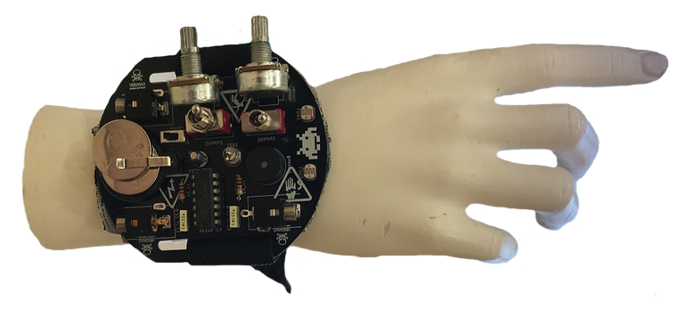

# ZapeSYNTHnica

> A light-playable, wearable stepped-tone synthesizer for curious hands and ears.

*A finished ZapeSYNTHnica worn as a bracelet. Photo: Klemen Šali and Monika Pocrnjić, from the [konS ZapeSYNTHnica labbook](https://wiki.alphawave.si/doku.php?id=kons:monika), licensed [CC BY 4.0](https://creativecommons.org/licenses/by/4.0/).*

## Project overview

ZapeSYNTHnica is a small analog synthesizer built directly onto a bracelet-shaped circuit board. Turn its controls, shade its light sensors, or connect it to other sound equipment: the instrument responds with raw square-wave pulses, stepped pitches, and playful electronic noise.

The project brings together experimental sound, DIY electronics, wearable technology, and PCB art. It can be approached as an expressive instrument, an introduction to soldering and analog synthesis, or a compact sound source for further experimentation.

## Concept and background

At the heart of ZapeSYNTHnica is the classic **stepped-tone generator**. Forrest M. Mims III first published the circuit as a “Sound Synthesizer” in *Engineer's Notebook: Integrated Circuit Applications* (1980), and later as a “Stepped Tone Generator.” The electronic-music community came to know versions of it as the **Atari Punk Console**, a name coined by Kaustic Machines in reference to its game-like tones.

ZapeSYNTHnica keeps that deliberately simple analog idea and gives it a wearable, tactile form. Its circuit board is not just a support for components: it is also the body, control surface, and visual identity of the instrument. The design grew through hands-on workshop practice, where making, listening, troubleshooting, and improvising happen together.

The workshop was developed by **Monika Pocrnjić and Klemen Šali** within *Spajkalčki*, a community of creative gatherings for exploring contemporary technologies and practical educational formats. The konS labbook presents the project as a beginner-friendly activity for ages 9 and up. A special limited board version was later designed for a 2023 workshop at Radiona in Zagreb.

## How ZapeSYNTHnica works

The **NE556** contains two 555-style timers in one 14-pin package. In this circuit:

1. The first timer runs as an astable audio oscillator.
2. Its repeating signal triggers the second timer, configured as a monostable multivibrator.
3. The second timer produces square output pulses whose duration is controlled independently.
4. Changing the oscillator rate and pulse duration creates the characteristic stepped-tone response.

Each timing control can use either a potentiometer or a light-dependent resistor (LDR), selected with a switch. Covering an LDR with a hand, moving under a lamp, or casting a moving shadow changes its resistance and therefore the sound. This turns ambient light and gesture into part of the instrument.

## Features and sound interaction

- Two hands-on sound controls for oscillator rate and output-pulse duration
- Two LDRs for playing the circuit with light and shadow
- Switchable manual or light-sensitive control for each timing section
- On-board piezo buzzer for immediate, self-contained sound
- LED activity indicator
- 3.5 mm connections for two external control inputs and one audio output
- CR2025 coin-cell power and an on/off switch
- Bracelet slots for attaching a wrist strap
- A circuit that invites component substitutions and sonic modification

The two external inputs connect to the NE556 control-voltage pins. They make it possible to experiment with external control signals and to place ZapeSYNTHnica alongside modular equipment. Treat it as an experimental interface rather than a standards-compliant Eurorack module: check voltage ranges, grounding, and output level before connecting it to other gear.

## Hardware and electronics

The repository preserves the original technical resources:

- [KiCad schematic](zapeSYNTHnica.sch) — legacy KiCad 5 Eeschema format
- [KiCad PCB design](zapeSYNTHnica4Radiona.kicad_pcb) — the Radiona board layout and PCB artwork
- [Bill of materials](Copy%20of%20zapeSYNTHnicavelenje.xlsx) — workshop quantities and component references
- [Illustrated build instructions](https://wiki.alphawave.si/doku.php?id=kons:monika) — the full konS labbook in Slovenian

The design uses through-hole parts, including an NE556N in a DIP-14 socket, two 1 kΩ resistors, two 100 kΩ potentiometers, two LDRs, two 0.22 µF timing capacitors, one 10 µF polarized capacitor, switches, an LED, a piezo buzzer, three 3.5 mm jacks, and a CR2025 holder. Consult the schematic and the board markings while building; the legacy BOM contains a few inconsistent text labels and is retained unchanged as source documentation.

The example PCB was created in **KiCad 5** with the [Svg2Shenzhen](https://github.com/badgeek/svg2shenzhen) Inkscape extension, which allowed illustration and copper-board design to meet in the same object.

## Photos and documentation

| Finished instrument | Circuit and construction |
| --- | --- |
|  | The [konS labbook](https://wiki.alphawave.si/doku.php?id=kons:monika) contains the schematic, component placement, step-by-step soldering photographs, polarity guidance, and troubleshooting notes. |
| Bracelet with populated PCB and controls. Photo: Klemen Šali and Monika Pocrnjić, CC BY 4.0. | Additional workshop photographs: [Radiona, Zagreb (2023)](https://radiona.org/monika-pocrnjic-radionica-zapesynthnica/) and [Drugo More, Rijeka (2024)](https://www.flickr.com/photos/drugomore/sets/72177720318059783). These remain externally linked because reuse permission is not stated clearly. |

Image provenance and reuse details are recorded in [images/README.md](images/README.md).

## Building your own ZapeSYNTHnica

Start with the [illustrated labbook](https://wiki.alphawave.si/doku.php?id=kons:monika) and use the files in this repository as the technical reference.

1. Review the schematic, PCB layout, and BOM before ordering parts.
2. Gather a temperature-controlled soldering iron, solder, flush cutters, pliers, tape, scissors, and the listed through-hole components.
3. Solder the low-profile parts first: resistors and timing capacitors.
4. Add the DIP socket and switches, observing the socket notch and board outlines.
5. Install the potentiometers, LDRs, battery holder, LED, polarized capacitor, buzzer, and audio jacks. Observe every polarity marking.
6. Insert the NE556 only after soldering is complete, then fit the CR2025 with its positive side facing as marked.
7. Inspect every joint and check for bridges before switching on. If the circuit is silent, remove the battery first, then check orientation, continuity, and solder joints.
8. Attach a suitable strap through the board slots and begin with the controls near their middle positions.

Solder in a ventilated workspace, keep hot tools away from flammable material, and use eye protection when trimming leads. Beginners should build with an experienced facilitator. The source files are fabrication resources, not a tested commercial kit release; verify footprints, clearances, component availability, and fabrication outputs before ordering boards.

## Workshops and educational context

ZapeSYNTHnica is designed for learning by making. A workshop can introduce:

- safe soldering and component orientation
- resistance, capacitance, oscillation, and pulse timing
- the 555/556 timer as a building block for sound
- photoresistors and environmental interaction
- signal flow, audio connections, and control voltage
- troubleshooting through inspection and continuity testing
- the artistic possibilities of circuits worn on the body

The project has appeared in konS educational programming in Maribor, including the **SYNTHbracelet** workshop in December 2021; at **Radiona** in Zagreb in June 2023; and at the **3N / AND Fair** in Rijeka in April 2024. These events frame the instrument as both a first electronics build and an open-ended tool for creative sound practice.

## Credits and acknowledgements

- **Workshop concept, development, and labbook:** Klemen Šali and Monika Pocrnjić
- **PCB design:** Monika Pocrnjić / MoniTronica; the board silkscreen also acknowledges inspiration from MONO Scarves
- **Workshop production and publication:** MKC Maribor and konS – Platform for Contemporary Investigative Art
- **Original stepped-tone circuit:** Forrest M. Mims III
- **“Atari Punk Console” name:** Kaustic Machines
- **Radiona edition and 2023 workshop host:** Radiona – Zagreb Makerspace
- **2024 workshop documentation:** Drugo More; photographs by Tanja Kanazir / Drugo More

The 2023 konS labbook states that its text and photographs are available under the [Creative Commons Attribution 4.0 International license](https://creativecommons.org/licenses/by/4.0/). The hardware files in this repository do not currently include an explicit hardware license; contact the project author before assuming permission for commercial reuse or redistribution.

## Useful links and resources

- [ZapeSYNTHnica konS labbook and build guide](https://wiki.alphawave.si/doku.php?id=kons:monika)
- [SYNTHbracelet workshop page, konS](https://kons-platforma.org/en/dogodki/synthbracelet/)
- [ZapeSYNTHnica workshop at Radiona, Zagreb](https://radiona.org/monika-pocrnjic-radionica-zapesynthnica/)
- [ZapeSYNTHnica workshop at 3N / AND Fair, Rijeka](https://www.flickr.com/photos/drugomore/sets/72177720318059783)
- [Forrest Mims on the Atari Punk Console circuit](https://www.jameco.com/Jameco/workshop/DIY/atari-punk-console.html)
- [NE556 dual timer datasheet, Texas Instruments](https://www.ti.com/lit/ds/symlink/ne556.pdf)
- [Svg2Shenzhen](https://github.com/badgeek/svg2shenzhen)
- [Monika Pocrnjić on GitHub](https://github.com/monitronica)
